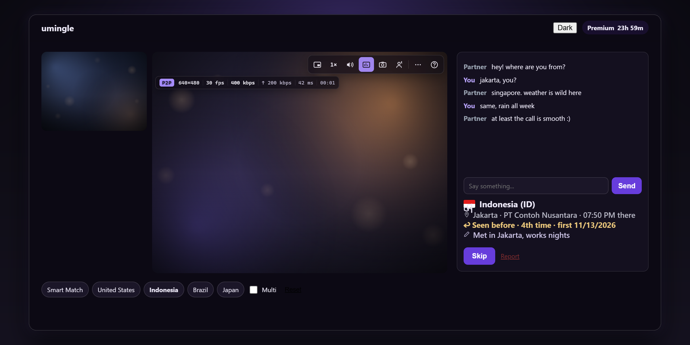
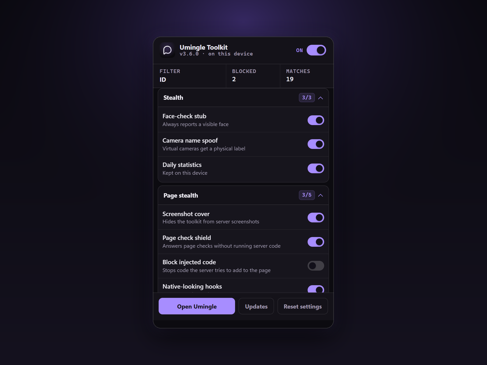
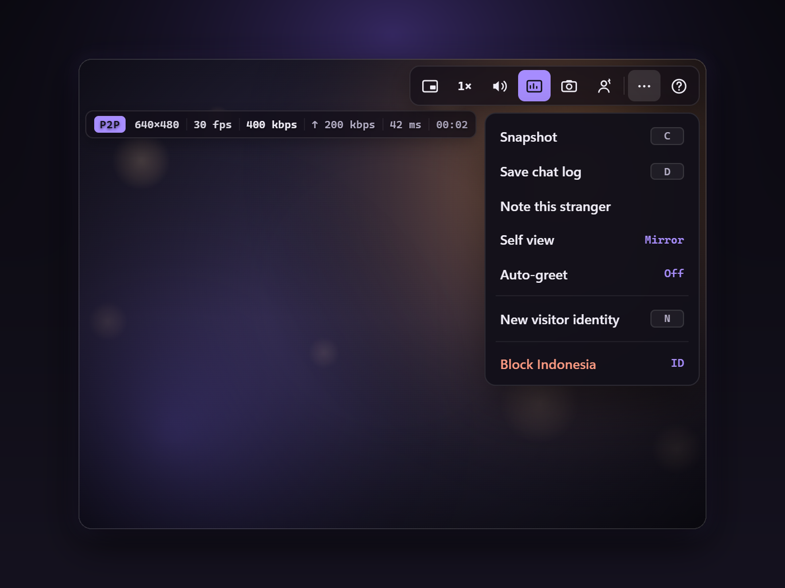
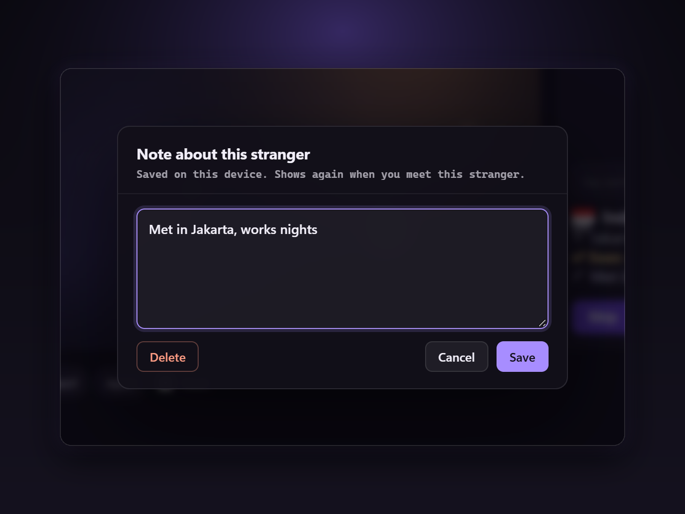
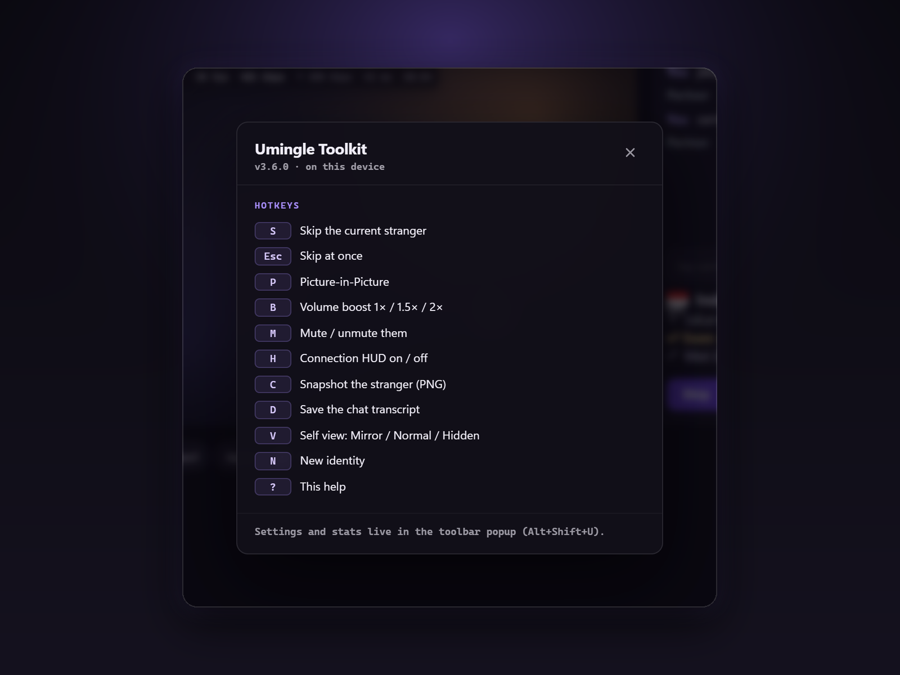

# Umingle Toolkit

**Improve your Umingle experience.**

Unlock Premium, call tools and privacy controls for
<https://umingle.com/video/>



## Install

Download the latest `umingle-toolkit-v*.zip` from Releases, unzip it, then:

1. Open `chrome://extensions` and turn on **Developer mode**.
2. Click **Load unpacked** and select the unzipped folder.

The toolbar icon (or `Alt+Shift+U`) opens settings. Edge, Brave and other
Chromium browsers work too.

## Features

**Premium and matching**

- Premium badge, banner and Extend button
- Country filter that actually skips other countries, plus a blocked list
- One-press skip with no "Really?" step
- Free-session wait notice hidden
- Auto-next and instant Escape skip

**Calls**

- Picture-in-Picture, volume boost, mute
- Connection HUD: resolution, fps, bitrate, ping
- Snapshot and chat transcript
- Self view, auto-greet, country and timer in the tab title
- Auto-skip for frozen or dead calls, wake lock, leave-page guard

**Stranger memory**

- Remembers strangers you have met and flags a repeat
- A note per stranger, shown again on the next meeting
- Everything stored locally; clear it from the popup

**Privacy and stealth**

- Hides the toolkit from server screenshots and page checks
- Blocks code the server injects, hides your IP in calls
- Camera and face-check spoofs, neutral moderation snapshot
- Fresh visitor per connection, moderator mode, multi-tab sessions

**Session safety**

- New identity button, ban notices hidden
- Login prompt, server redirects and Premium resets ignored
- Server text-chat cut-off ignored mid-call
- Anti-report: report button hidden
- Ban check remembers the address and asks you to change IP before New
  identity

Hotkeys: `S` skip · `Esc` instant skip · `P` PiP · `B` boost · `M` mute ·
`H` HUD · `C` snapshot · `D` chat log · `V` self view · `N` new identity ·
`?` help. They stay quiet while you type in chat.

The extension checks GitHub for a newer release every 6 hours. When one
exists, the toolbar icon shows a badge and the popup links to the download.

## Screenshots

| | |
| --- | --- |
| <br>**Settings**<br>Filters, block list and the day's stats | <br>**In-call tools**<br>HUD, snapshot, chat log, notes, self view |
| <br>**Stranger note**<br>Saved locally, back on the next meeting | <br>**Hotkeys**<br>Every shortcut on one card |

## Development

Plain JavaScript, no framework. `src/main-world.js` runs in the page world at
`document_start`; `src/bridge.js` and `src/toolkit.js` run isolated and talk to
it over `window.postMessage`.

Releases ship a minified build. `npm run build` writes `dist/` with minified
scripts and styles, copied icons and the manifest:

```bash
npm install
npm run build
```

Load `dist/` with **Load unpacked** to test the shipped build, or load the
repository folder to run from source.

Offline end-to-end suite (Playwright, local harness, 327 checks):

```bash
pip install playwright
python -m playwright install chromium
python test/build_ext_test.py
python test/test_extension.py
```

`UMINGLE_TEST_CHROME=/path/to/chrome` points the suite at a specific Chromium.
The suite never touches umingle.com.

### Releases

Bump the version in `manifest.json` and `package.json`, then push a
`v<version>` tag. The workflow in `.github/workflows/release.yml` builds
`dist/` and attaches it as `umingle-toolkit-<tag>.zip`.

## License

MIT - see [LICENSE](LICENSE).
